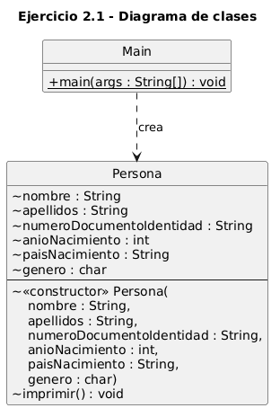
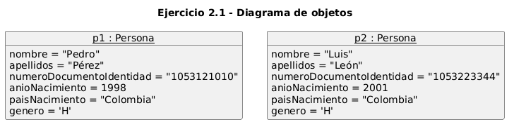

# Ejercicio 2.1 — Definición de clases (clase `Persona`)

**Libro:** Leonardo Bermón Angarita, *Ejercicios de programación orientada a objetos con Java y UML*.
**Páginas impresas consultadas:** 61–66. El enunciado está en la página 63 y los ejercicios propuestos en la página 66.

## Objetivo

Modelar una persona mediante una clase, crear dos objetos con el constructor e imprimir el valor de sus atributos. La solución del libro ya define cuatro atributos. Esta versión también incorpora los tres puntos de «Ejercicios propuestos».

## Atributos de `Persona`

| Atributo | Tipo | Origen |
| --- | --- | --- |
| `nombre` | `String` | Enunciado original |
| `apellidos` | `String` | Enunciado original |
| `numeroDocumentoIdentidad` | `String` | Enunciado original |
| `anioNacimiento` | `int` | Enunciado original |
| `paisNacimiento` | `String` | Ejercicio propuesto |
| `genero` | `char` (`'H'` o `'M'`) | Ejercicio propuesto |

El constructor recibe los seis valores y los asigna con `this`. El método `imprimir()` es `void` y muestra los seis atributos.

Los identificadores van sin tildes (`anioNacimiento`, `numeroDocumentoIdentidad`, `paisNacimiento`, `genero`) para facilitar la compilación. En el libro aparecen como `añoNacimiento` y `númeroDocumentoIdentidad`.

## Datos de prueba

Se conservan las dos personas del libro:

| Objeto | Nombre | Apellidos | Documento | Año |
| --- | --- | --- | --- | --- |
| `p1` | Pedro | Pérez | 1053121010 | 1998 |
| `p2` | Luis | León | 1053223344 | 2001 |

**Datos de ejemplo, no especificados por el libro:** para ambas personas se usó país de nacimiento `Colombia` y género `'H'`.

## Modificaciones de los ejercicios propuestos

1. Se agregaron `paisNacimiento` (`String`) y `genero` (`char`).
2. El constructor ahora recibe e inicializa esos dos atributos con `this`.
3. `imprimir()` también muestra el país de nacimiento y el género.

El programa principal está en `Main.java`, separado de `Persona.java`. En el libro, `main` aparece dentro de `Persona`; la separación no cambia el comportamiento.

## Nota sobre el libro

En la explicación del diagrama de clases (p. 65), el texto dice que `nombre`, `apellidos` y `añoNacimiento` son de tipo `int`, y que `númeroDocumentoIdentidad` es `String`. El código de la solución, en las páginas 63–64, define `nombre` y `apellidos` como `String` y solo `añoNacimiento` como `int`. Esta implementación sigue el código y el enunciado, no esa frase de la explicación.

Los atributos, el constructor y `imprimir()` tienen visibilidad de paquete (`~`), como en la solución del libro. `paisNacimiento` y `genero` corresponden a los ejercicios propuestos. `Main` está en la misma carpeta y puede usarlos.

## Compilar y ejecutar

Desde la carpeta `ejercicio_2_1`, con el JDK instalado:

```text
javac -encoding UTF-8 Persona.java Main.java
java Main
```

No se usan Maven, Gradle ni otras dependencias.

## Resultado esperado

```text
Nombre = Pedro
Apellidos = Pérez
Número de documento de identidad = 1053121010
Año de nacimiento = 1998
País de nacimiento = Colombia
Género = H

Nombre = Luis
Apellidos = León
Número de documento de identidad = 1053223344
Año de nacimiento = 2001
País de nacimiento = Colombia
Género = H
```

## Diagramas UML

El diagrama de clases sigue la estructura del libro: nombre de la clase, atributos con tipo y operaciones. El constructor lleva el estereotipo `<<constructor>>`. Se añaden `paisNacimiento`, `genero` y la clase `Main`, que no está en la figura original porque en el libro `main` vive dentro de `Persona`.

El diagrama de objetos muestra las instancias `p1` y `p2` con los seis valores usados en la ejecución.

### Diagrama de clases



Código fuente: [uml/diagrama_clases.puml](uml/diagrama_clases.puml)

### Diagrama de objetos



Código fuente: [uml/diagrama_objetos.puml](uml/diagrama_objetos.puml)
