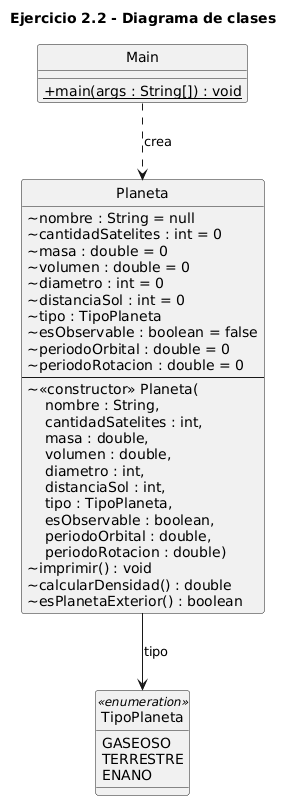
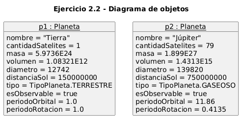

# Ejercicio 2.2 — Definición de atributos con tipos primitivos (clase `Planeta`)

**Libro:** Leonardo Bermón Angarita, *Ejercicios de programación orientada a objetos con Java y UML*.
**Páginas impresas consultadas:** 66–73. El enunciado empieza en la página 67, la solución y las figuras 2.4 y 2.5 están en las páginas 69–72, y la ejecución y los ejercicios propuestos están en la página 73.

## Objetivos de aprendizaje

- Definir atributos con tipos primitivos y con una enumeración.
- Asignar valores iniciales a los atributos.
- Crear objetos con un constructor, imprimir su estado, calcular la densidad y decidir si un planeta es exterior.

## Clase `Planeta`

Un planeta tiene nombre, satélites, masa, volumen, diámetro, distancia al Sol, tipo, si es observable y, por los ejercicios propuestos, período orbital y período de rotación. El constructor recibe esos diez valores y los asigna con `this`.

| Atributo | Tipo | Valor inicial | Unidad |
| --- | --- | --- | --- |
| `nombre` | `String` | `null` | — |
| `cantidadSatelites` | `int` | `0` | cantidad |
| `masa` | `double` | `0` | kilogramos |
| `volumen` | `double` | `0` | kilómetros cúbicos |
| `diametro` | `int` | `0` | kilómetros |
| `distanciaSol` | `int` | `0` | kilómetros |
| `tipo` | `TipoPlaneta` | sin valor explícito | — |
| `esObservable` | `boolean` | `false` | — |
| `periodoOrbital` | `double` | `0` | años |
| `periodoRotacion` | `double` | `0` | días |

Los identificadores van sin tildes. En el libro aparecen como `cantidadSatélites` y `diámetro`.

## Enumeración `TipoPlaneta`

Valores exactos: `GASEOSO`, `TERRESTRE` y `ENANO`. Está en `TipoPlaneta.java`. En el libro la enumeración se declara dentro de `Planeta` con el nombre `tipoPlaneta`; separarla no cambia los tres valores.

En el listado del libro, Júpiter se crea con `tipoPlaneta.gaseoso`. Ese nombre no existe: la constante es `GASEOSO`, como muestran el diagrama de objetos y la ejecución. Aquí se usa `TipoPlaneta.GASEOSO`.

## Métodos

- `imprimir(): void` muestra los diez atributos e indica las unidades de masa, volumen, diámetro, distancia y de los dos períodos.
- `calcularDensidad(): double` devuelve `masa / volumen`, en kg/km³. No se convierte a kg/m³. Si el volumen es cero, devuelve `0` para no dividir por cero; Tierra y Júpiter tienen volumen distinto de cero, así que su resultado no cambia.
- `esPlanetaExterior(): boolean` devuelve verdadero cuando `distanciaSol > 3.4 * 149597870`. Una UA equivale a 149597870 km y 3.4 UA es el límite exterior del cinturón de asteroides. El libro guarda ese límite en un `float`; aquí la comparación se hace en `double`, con el mismo criterio. Para Tierra y Júpiter el resultado booleano coincide.

## Ejercicios propuestos

1. `periodoOrbital`, en años.
2. `periodoRotacion`, en días.
3. El constructor y `imprimir()` inicializan y muestran ambos valores.

Los ocho atributos originales se conservan.

## Datos de Tierra y Júpiter

| Dato | Tierra (`p1`) | Júpiter (`p2`) |
| --- | --- | --- |
| Satélites | 1 | 79 |
| Masa (kg) | 5.9736E24 | 1.899E27 |
| Volumen (km³) | 1.08321E12 | 1.4313E15 |
| Diámetro (km) | 12742 | 139820 |
| Distancia al Sol (km) | 150000000 | 750000000 |
| Tipo | `TERRESTRE` | `GASEOSO` |
| Observable | `true` | `true` |

**Datos de ejemplo, no especificados por el libro:** período orbital y de rotación. Tierra: 1.0 años y 1.0 días. Júpiter: 11.86 años y 0.4135 días.

La densidad de la Tierra es 5.514720137369484E12 kg/km³ y la de Júpiter es 1.3267658771745964E12 kg/km³. Esos cocientes coinciden con la figura 2.6 y con una división independiente de los mismos literales. La Tierra no es exterior; Júpiter sí.

## Notas sobre el libro

La figura 2.4 está rotulada como diagrama del ejercicio 2.4. Corresponde al ejercicio 2.2. El enunciado escribe `Sring` en lugar de `String`.

## Compilar y ejecutar

Desde la carpeta `ejercicio_2_2`, con JDK 21:

```text
javac -encoding UTF-8 TipoPlaneta.java Planeta.java Main.java
java Main
```

No se usan Maven, Gradle ni otras dependencias. Este ejercicio se compila aparte del 2.1.

## Resultado esperado

```text
Nombre del planeta = Tierra
Cantidad de satélites = 1
Masa del planeta (kg) = 5.9736E24
Volumen del planeta (km3) = 1.08321E12
Diámetro del planeta (km) = 12742
Distancia al Sol (km) = 150000000
Tipo de planeta = TERRESTRE
Es observable = true
Período orbital (años) = 1.0
Período de rotación (días) = 1.0
Densidad del planeta (kg/km3) = 5.514720137369484E12
Es planeta exterior = false

Nombre del planeta = Júpiter
Cantidad de satélites = 79
Masa del planeta (kg) = 1.899E27
Volumen del planeta (km3) = 1.4313E15
Diámetro del planeta (km) = 139820
Distancia al Sol (km) = 750000000
Tipo de planeta = GASEOSO
Es observable = true
Período orbital (años) = 11.86
Período de rotación (días) = 0.4135
Densidad del planeta (kg/km3) = 1.3267658771745964E12
Es planeta exterior = true
```

## Diagramas UML

El diagrama de clases incluye `Planeta` con sus diez atributos, el constructor y los tres métodos; `TipoPlaneta` con el estereotipo `«enumeration»`, unida a `Planeta` por el atributo `tipo`; y `Main`, que crea los planetas. El de objetos muestra `p1` y `p2` con los valores de la ejecución. Los encabezados de las instancias van subrayados.

### Diagrama de clases



Código fuente: [uml/diagrama_clases.puml](uml/diagrama_clases.puml)

### Diagrama de objetos



Código fuente: [uml/diagrama_objetos.puml](uml/diagrama_objetos.puml)
