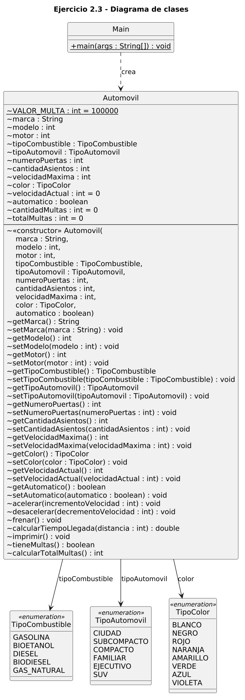
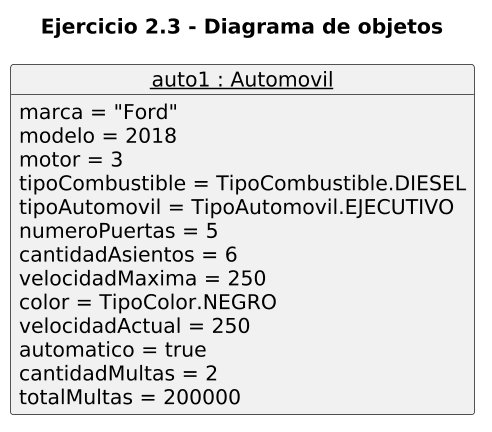

# Ejercicio 2.3 — Estado de un objeto (clase `Automovil`)

**Libro:** Leonardo Bermón Angarita, *Ejercicios de programación orientada a objetos con Java y UML*.
**Páginas impresas consultadas:** 73–86. El enunciado empieza en la página 74, la solución ocupa las páginas 75–83, las figuras 2.7, 2.8 y 2.9 están en las páginas 84–85, y los ejercicios propuestos están en la página 86.

## Objetivo

Modelar un automóvil cuyo estado cambia al consultar y modificar sus atributos, al variar su velocidad y al registrar multas si se intenta superar la velocidad máxima.

## Clase `Automovil`

El constructor recibe los datos del vehículo y la transmisión automática. La velocidad actual empieza en 0 y no es parámetro del constructor. Cada asignación usa `this`.

| Atributo | Tipo | Valor inicial | Unidad o significado |
| --- | --- | --- | --- |
| `marca` | `String` | — | Fabricante |
| `modelo` | `int` | — | Año del modelo |
| `motor` | `int` | — | Cilindraje, como en el libro |
| `tipoCombustible` | `TipoCombustible` | — | Enumeración |
| `tipoAutomovil` | `TipoAutomovil` | — | Enumeración |
| `numeroPuertas` | `int` | — | Cantidad de puertas |
| `cantidadAsientos` | `int` | — | Cantidad de asientos |
| `velocidadMaxima` | `int` | — | km/h |
| `color` | `TipoColor` | — | Enumeración |
| `velocidadActual` | `int` | `0` | km/h |
| `automatico` | `boolean` | — | Transmisión automática |
| `cantidadMultas` | `int` | `0` | Número de infracciones |
| `totalMultas` | `int` | `0` | Pesos colombianos |
| `VALOR_MULTA` | `int` | `100000` | Constante, COP por infracción |

Los identificadores van sin tildes. En el libro aparecen como `númeroPuertas`, `velocidadMáxima` y `Automóvil`.

## Enumeraciones

| Enumeración | Constantes |
| --- | --- |
| `TipoCombustible` | `GASOLINA`, `BIOETANOL`, `DIESEL`, `BIODIESEL`, `GAS_NATURAL` |
| `TipoAutomovil` | `CIUDAD`, `SUBCOMPACTO`, `COMPACTO`, `FAMILIAR`, `EJECUTIVO`, `SUV` |
| `TipoColor` | `BLANCO`, `NEGRO`, `ROJO`, `NARANJA`, `AMARILLO`, `VERDE`, `AZUL`, `VIOLETA` |

En el libro están declaradas dentro de `Automovil` con los nombres `tipoCom`, `tipoA` y `tipoColor`. Aquí cada una tiene su archivo. La constante del biodiesel figura en el libro como `BIODISESEL`; en esta solución se escribe `BIODIESEL`.

## Métodos y estado del objeto

Los getters consultan un atributo y los setters lo reemplazan. Así se lee y se cambia el estado del automóvil.

- `setVelocidadActual` solo acepta un valor entre 0 y `velocidadMaxima`, incluidos ambos.
- `setVelocidadMaxima` rechaza un valor menor o igual a cero, o inferior a la velocidad actual. En esos casos muestra un mensaje y conserva la velocidad máxima anterior.
- `acelerar` suma el incremento si el resultado no pasa de la velocidad máxima. Puede quedar exactamente en ese límite. Un incremento negativo no se aplica.
- `desacelerar` resta el decremento y puede dejar la velocidad en cero. No acepta un decremento negativo ni una velocidad negativa.
- `frenar` pone la velocidad actual en 0.
- `calcularTiempoLlegada` devuelve `distancia / velocidadActual` en horas, con división real. Si la velocidad es 0, devuelve `NaN`.
- `imprimir` muestra todos los atributos e indica las unidades de velocidad y de las multas.
- `tieneMultas` devuelve verdadero si hay al menos una multa.
- `calcularTotalMultas` devuelve el acumulado en pesos. Si no hay multas, devuelve 0.

## Ejercicios propuestos

1. `automatico` indica si la transmisión es automática. Entra en el constructor, en `imprimir` y tiene `getAutomatico` y `setAutomatico`.
2. Si `acelerar` intenta superar la velocidad máxima, la velocidad no cambia y se suma una multa de `VALOR_MULTA`. Cada nuevo intento suma otra.
3. `tieneMultas` y `calcularTotalMultas` consultan ese registro.

**El valor de 100000 COP es un supuesto de esta implementación.** El libro no fija una tarifa. No corresponde a una sanción legal.

## Vehículo de prueba

Ford, modelo 2018, motor 3, combustible `DIESEL`, tipo `EJECUTIVO`, 5 puertas, 6 asientos, velocidad máxima 250 km/h, color `NEGRO` y velocidad inicial 0. `automatico = true` es un ejemplo añadido para el ejercicio propuesto.

## Secuencia y resultados

La secuencia del libro produce estas velocidades: 100, 120, 70 y 0 km/h. Al intentar desacelerar otros 20 km/h aparece el mensaje de velocidad negativa.

Con la velocidad en 70 km/h, el tiempo para 140 km es 2.0 horas. Esa consulta se hace antes de frenar, porque después la velocidad es cero.

Luego, desde 0 km/h, dos aceleraciones de 251 km/h no cambian la velocidad y dejan dos multas: `tieneMultas` es `true` y el total es 200000 COP. Una aceleración de 250 km/h llega exactamente al límite y no agrega otra multa.

El diagrama de objetos muestra ese estado final: velocidad 250 km/h, 2 multas y 200000 COP. La figura 2.8 del libro muestra el estado inicial, con velocidad 0.

## Correcciones respecto del libro

- `acelerar` del libro usa `< velocidadMaxima`, así que no permite quedar exactamente en el límite. Aquí sí se permite.
- `desacelerar` del libro exige que el resultado sea mayor que cero, así que no permite detenerse con ese método. Aquí se permite llegar a cero. La prueba del libro, desacelerar 20 km/h estando detenido, sigue mostrando el mismo mensaje.
- `calcularTiempoLlegada` divide dos enteros y pierde los decimales. Aquí la distancia se convierte a `double`. Con velocidad 0 el libro dividiría por cero; este programa devuelve `NaN`.
- `imprimir` del libro no muestra la velocidad actual y escribe «Velocida máxima». Aquí se imprimen todos los atributos y la palabra queda corregida.
- `setVelocidadActual` del libro asigna cualquier entero. Aquí rechaza valores negativos o superiores a la velocidad máxima.
- `setVelocidadMaxima` del libro también asigna cualquier entero. Aquí rechaza valores menores o iguales a cero y valores inferiores a la velocidad actual.

## Compilar y ejecutar

Desde `ejercicio_2_3`, con JDK 21:

```text
javac -encoding UTF-8 TipoCombustible.java TipoAutomovil.java TipoColor.java Automovil.java Main.java
java Main
```

No se usan Maven, Gradle ni otras dependencias.

## Resultado esperado

```text
Marca = Ford
Modelo = 2018
Motor = 3
Tipo de combustible = DIESEL
Tipo de automóvil = EJECUTIVO
Número de puertas = 5
Cantidad de asientos = 6
Velocidad máxima (km/h) = 250
Color = NEGRO
Velocidad actual (km/h) = 0
Automático = true
Cantidad de multas = 0
Total de multas (COP) = 0
Velocidad actual = 100
Velocidad actual = 120
Velocidad actual = 70
Tiempo de llegada para 140 km = 2.0 horas
Velocidad actual = 0
No se puede decrementar a una velocidad negativa.

Comprobación de multas
Tiene multas = false
Total de multas (COP) = 0
No se puede incrementar a una velocidad superior a la máxima del automóvil.
Se generó una multa de 100000 COP.
Velocidad actual = 0
No se puede incrementar a una velocidad superior a la máxima del automóvil.
Se generó una multa de 100000 COP.
Velocidad actual = 0
Tiene multas = true
Total de multas (COP) = 200000
Velocidad actual = 250
Tiene multas = true
Total de multas (COP) = 200000
```

## Diagramas UML

### Diagrama de clases



Código fuente: [uml/diagrama_clases.puml](uml/diagrama_clases.puml)

### Diagrama de objetos

Estado final de `auto1`, después de la comprobación de multas y de alcanzar 250 km/h.



Código fuente: [uml/diagrama_objetos.puml](uml/diagrama_objetos.puml)
