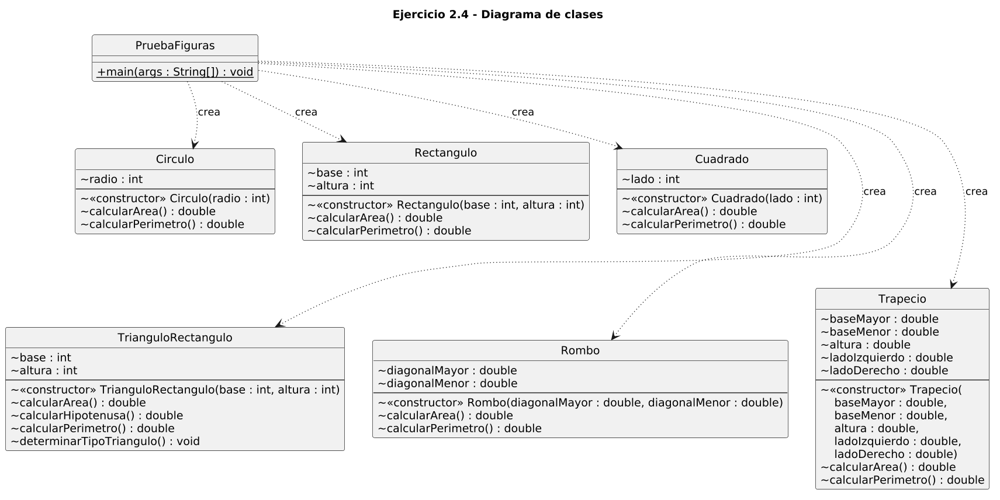
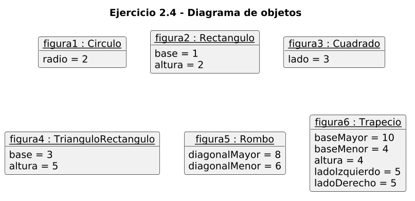

# Ejercicio 2.4 — Métodos con y sin valores de retorno

**Libro:** Leonardo Bermón Angarita, *Ejercicios de programación orientada a objetos con Java y UML*.
**Páginas impresas consultadas:** 86–95. El enunciado está en la página 87, el código en las páginas 88–93, las figuras 2.10, 2.11 y 2.12 en las páginas 94–95, y los ejercicios propuestos en la página 95.

## Objetivos de aprendizaje

- Definir métodos que devuelven un valor y métodos `void`.
- Separar los datos de cada figura en su propia clase.
- Crear los objetos desde una clase de prueba, `PruebaFiguras`.

Las seis figuras son clases independientes. No hay herencia ni polimorfismo.

## Clases

| Clase | Atributos | Métodos |
| --- | --- | --- |
| `Circulo` | `radio: int` | `calcularArea`, `calcularPerimetro` |
| `Rectangulo` | `base: int`, `altura: int` | `calcularArea`, `calcularPerimetro` |
| `Cuadrado` | `lado: int` | `calcularArea`, `calcularPerimetro` |
| `TrianguloRectangulo` | `base: int`, `altura: int` | `calcularArea`, `calcularHipotenusa`, `calcularPerimetro`, `determinarTipoTriangulo` |
| `Rombo` | `diagonalMayor: double`, `diagonalMenor: double` | `calcularArea`, `calcularPerimetro` |
| `Trapecio` | `baseMayor`, `baseMenor`, `altura`, `ladoIzquierdo`, `ladoDerecho`, todos `double` | `calcularArea`, `calcularPerimetro` |

Las cuatro figuras del libro usan centímetros y atributos `int`. El rombo y el trapecio también se miden en centímetros, con atributos `double`. Los constructores asignan los parámetros con `this`. El área y el perímetro no se guardan: se calculan al invocar el método.

## Fórmulas

| Figura | Área | Perímetro |
| --- | --- | --- |
| Círculo | π × radio² | 2 × π × radio |
| Rectángulo | base × altura | 2 × (base + altura) |
| Cuadrado | lado² | 4 × lado |
| Triángulo rectángulo | (base × altura) / 2 | base + altura + hipotenusa |
| Rombo | (diagonal mayor × diagonal menor) / 2 | 4 × lado |
| Trapecio | ((base mayor + base menor) × altura) / 2 | suma de los cuatro lados |

La hipotenusa es √(base² + altura²). El lado del rombo se obtiene de las semidiagonales: √[(d₁ / 2)² + (d₂ / 2)²].

## Clasificación del triángulo

`determinarTipoTriangulo` es `void` y escribe el resultado. Compara los dos catetos y la hipotenusa:

- Equilátero: los tres lados iguales.
- Isósceles: dos lados iguales.
- Escaleno: los tres lados diferentes.

Un triángulo rectángulo con lados positivos no puede ser equilátero. Si los catetos son iguales, es isósceles; si no, es escaleno. Con base 3 y altura 5 el resultado es escaleno. Una comprobación adicional, con catetos 4 y 4, lo clasifica como isósceles. Ese segundo triángulo no forma parte de las seis instancias del diagrama de objetos.

## Ejercicios propuestos

El libro pide las clases `Rombo` y `Trapecio`, sin indicar sus atributos.

- El rombo usa las dos diagonales. El lado no se guarda aparte, para que coincida con esas diagonales.
- El trapecio usa las dos bases, la altura y los dos lados no paralelos. Las bases y la altura bastan para el área, pero no para el perímetro de un trapecio general.

**Datos añadidos, no incluidos en la solución original del libro:**

| Figura | Datos | Área | Perímetro |
| --- | --- | --- | --- |
| Rombo | diagonales 8 cm y 6 cm | 24 cm² | 20 cm |
| Trapecio isósceles | bases 10 cm y 4 cm, altura 4 cm, lados 5 cm y 5 cm | 28 cm² | 24 cm |

Esos lados de 5 cm son coherentes con la diferencia de bases y la altura: cada saliente mide 3 cm y √(3² + 4²) = 5.

## Datos originales y resultados

| Figura | Área (cm²) | Perímetro (cm) |
| --- | --- | --- |
| Círculo, radio 2 | 12.566370614359172 | 12.566370614359172 |
| Rectángulo 1 × 2 | 2.0 | 6.0 |
| Cuadrado, lado 3 | 9.0 | 12.0 |
| Triángulo 3 × 5 | 7.5 | 13.8309518948453 |

La hipotenusa de ese triángulo es 5.830951894845301 cm, es decir √34. Estos valores coinciden con una comprobación independiente de las mismas fórmulas. En la figura 2.12 el área del triángulo aparece como 7.0.

## Correcciones respecto del libro

- `calcularArea` del triángulo divide dos enteros, `(base * altura / 2)`, y por eso la ejecución del libro muestra 7.0. Aquí se divide por `2.0`, así que el área es 7.5. El método sigue devolviendo `double`.
- La comparación del libro usa `==` entre un `int` y la hipotenusa `double`. Aquí la hipotenusa se compara con una tolerancia pequeña. El comentario del libro llama «escaleno» al caso que el mensaje imprime como isósceles.
- Los identificadores van sin tildes: `Circulo`, `Rectangulo`, `TrianguloRectangulo`, `calcularPerimetro` y `determinarTipoTriangulo`.
- En el cuadrado, el rectángulo y el triángulo, las multiplicaciones y las sumas del área y del perímetro se hacen en `double`. Así un lado grande no desborda el rango de `int`. La hipotenusa usa `Math.hypot`. Si algún cateto no es positivo, el triángulo no se clasifica.

## Compilar y ejecutar

Desde `ejercicio_2_4`, con JDK 21:

```text
javac -encoding UTF-8 Circulo.java Rectangulo.java Cuadrado.java TrianguloRectangulo.java Rombo.java Trapecio.java PruebaFiguras.java
java PruebaFiguras
```

No se usan Maven, Gradle ni otras dependencias. Este ejercicio se compila aparte de los anteriores.

## Diagramas UML

El diagrama de clases muestra las seis figuras y `PruebaFiguras`, cuyo `main` es estático. No hay herencia entre las figuras. El de objetos muestra `figura1` a `figura6` solo con los atributos guardados en cada objeto.

### Diagrama de clases



Código fuente: [uml/diagrama_clases.puml](uml/diagrama_clases.puml)

### Diagrama de objetos



Código fuente: [uml/diagrama_objetos.puml](uml/diagrama_objetos.puml)
