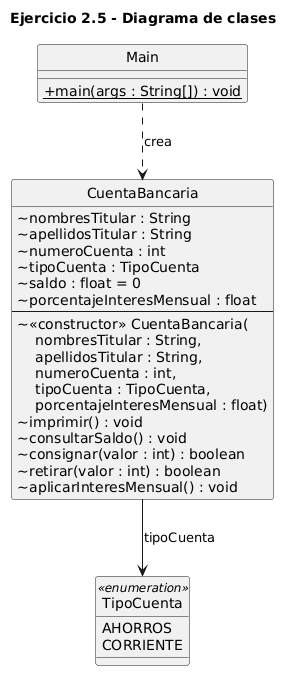
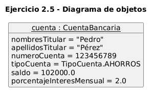

# Ejercicio 2.5 — Definición de métodos con parámetros (clase `CuentaBancaria`)

**Libro:** Leonardo Bermón Angarita, *Ejercicios de programación orientada a objetos con Java y UML*.
**Páginas impresas consultadas:** 95–101. El enunciado está en la página 96, el código en las páginas 97–100, las figuras 2.13, 2.14 y 2.15 en las páginas 100–101, y los ejercicios propuestos en la página 101.

## Objetivo

Definir métodos con parámetros de entrada. La cuenta permite consultar sus datos, consignar, retirar y aplicar un interés mensual.

## Clase `CuentaBancaria`

| Atributo | Tipo | Valor inicial |
| --- | --- | --- |
| `nombresTitular` | `String` | — |
| `apellidosTitular` | `String` | — |
| `numeroCuenta` | `int` | — |
| `tipoCuenta` | `TipoCuenta` | — |
| `saldo` | `float` | `0` |
| `porcentajeInteresMensual` | `float` | lo recibe el constructor |

El número de cuenta sigue siendo `int` y el saldo `float`, como en el libro. El saldo no es parámetro del constructor. Los identificadores van sin tildes: en el libro el número aparece como `númeroCuenta`.

## Enumeración `TipoCuenta`

Valores: `AHORROS` y `CORRIENTE`. Está en `TipoCuenta.java`. En el libro se declara dentro de la cuenta con el nombre `tipo`.

## Constructor

Recibe nombres, apellidos, número, tipo de cuenta y porcentaje de interés mensual. Asigna esos datos con `this` y deja el saldo en cero.

## Métodos originales

- `imprimir(): void` muestra todos los atributos, incluido el interés mensual.
- `consultarSaldo(): void` imprime el saldo. No lo devuelve.
- `consignar(int valor): boolean` suma el valor si es mayor que cero. Si no, muestra un mensaje, devuelve `false` y no cambia el saldo.
- `retirar(int valor): boolean` resta el valor si es mayor que cero y menor o igual que el saldo. Se puede retirar todo el dinero y dejar la cuenta en cero. Un valor inválido devuelve `false` y no cambia el saldo.

El mensaje del libro dice que el retiro debe ser menor que el saldo, pero la condición del código es `valor <= saldo`. El mensaje de esta solución admite ese caso: el valor debe ser mayor que cero y menor o igual que el saldo actual.

## Ejercicios propuestos

1. `porcentajeInteresMensual` guarda la tasa como porcentaje.
2. `aplicarInteresMensual(): void` calcula el interés y lo suma al saldo.

```text
interes = saldo * (porcentajeInteresMensual / 100)
saldo = saldo + interes
```

El libro no fija el nombre del método, su retorno ni una tasa numérica. Aquí el método es `void` y la tasa de ejemplo es **2 % mensual** (`2.0f`). No es la tasa de un banco real. El cálculo permanece en `float`.

Con saldo 100000 y tasa 2 %, el interés es 2000 y el saldo queda en 102000. Con saldo cero, el interés es cero.

## Secuencia del libro

Cuenta de Pedro Pérez, número 123456789, tipo `AHORROS`, saldo inicial 0.

| Operación | Saldo |
| --- | ---: |
| Creación | 0 |
| Consignar 200000 | 200000 |
| Consignar 300000 | 500000 |
| Retirar 400000 | 100000 |
| Interés del 2 % | 102000 |

`consultarSaldo()` confirma 100000 antes del interés y 102000 después. El método guarda ese saldo en el objeto.

La figura 2.14 muestra la cuenta recién creada, con saldo 0. El diagrama de objetos de esta carpeta muestra el estado final: saldo 102000 y interés 2 %.

Una segunda cuenta, que no aparece en ese diagrama, comprueba consignaciones y retiros en cero o negativos, un retiro mayor que el saldo, un retiro igual al saldo y el interés con saldo cero. Esas operaciones devuelven `false` cuando son inválidas y no modifican el saldo. La cuenta de Pedro permanece en 102000.

La figura 2.13 también dibuja `compararCuentas` y `transferencia`. Esas operaciones pertenecen al ejercicio 2.6 y no forman parte de esta solución.

## Compilar y ejecutar

Desde `ejercicio_2_5`, con JDK 21:

```text
javac -encoding UTF-8 TipoCuenta.java CuentaBancaria.java Main.java
java Main
```

No se usan Maven, Gradle ni otras dependencias.

## Diagramas UML

### Diagrama de clases



Código fuente: [uml/diagrama_clases.puml](uml/diagrama_clases.puml)

### Diagrama de objetos

Estado final de la cuenta de Pedro, después de las transacciones y del interés mensual.



Código fuente: [uml/diagrama_objetos.puml](uml/diagrama_objetos.puml)
